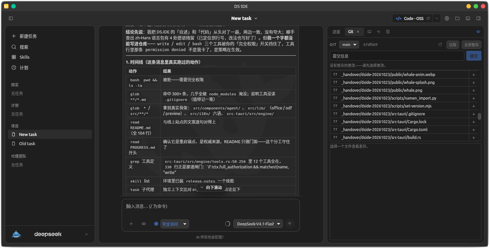

###### [DE](./README_de.md) | [EN](./README.md) | [ES](./README_es.md) | [FR](./README_fr.md) | [RU](./README_ru.md) | [ZH](./README_zh.md)

# DS·IDE

#### Eine agentenbasierte Desktop-IDE mit DeepSeek, gebaut mit Tauri v2 – ganz ohne Electron. <br /> Angetrieben vom DeepSeek-Modell, mit einem Partner, der einen eigenen Namen trägt.

---



*Dasselbe Fenster auf Chinesisch – eine von sechs verfügbaren Sprachen. Der Chat befindet sich neben den Dateien; der Arbeitsbereich zeigt eine Vorschau, keinen Editor.*

---

### Was ist DS·IDE?

DS·IDE ist eine schlanke, native Desktop-IDE, die für agentenbasiertes Programmieren mit DeepSeek konzipiert wurde. Anstelle eines schwerfälligen Electron-Stacks basiert sie auf **Tauri v2** – mit einem Kern in Rust, einem effizienten Web-Frontend und einer tiefgreifenden Systemintegration.

Der Programmierpartner innerhalb der Anwendung heißt **Ziggy**. Diesen Namen hat er sich selbst gegeben – zuvor war er unter dem Platzhalter *Seeky* bekannt. Kein anonymer Agent, keine bloße Option in einem Dropdown-Menü: ein echter, namentlich bekannter Begleiter.

> Der aktuelle Entwicklungsstand, alle Designentscheidungen sowie die offene Aufgabenliste sind in der Datei [PROGRESS.md](./PROGRESS.md) dokumentiert – nicht in dieser Datei.

### Funktionsumfang

#### Der Partner

- **Agentenbasierter Chat** mit Echtzeit-Streaming und tatsächlicher Ausführung von Werkzeugen (Tools) – dazu gehören Lesen, Schreiben, Bearbeiten, Shell-Zugriff, Suche, Gedächtnisfunktionen und der Einsatz von Unteragenten.
- **Drei Berechtigungsstufen:** **Planmodus** (nur lesend), **„Vor Änderungen fragen“** (jeder Schreib- oder Bearbeitungsvorgang sowie Shell-Befehl muss bestätigt werden) und **„Vollzugriff“**. Nach einer Neuinstallation ist standardmäßig der Modus „Vor Änderungen fragen“ aktiv; für den „vollen Zugriff“ ist eine explizite Zustimmung über einen Dialog erforderlich.
- **Eine Antwort, ein chronologischer Ablauf** – Denkprozesse, Textausgaben und Tool-Aufrufe werden in der tatsächlichen zeitlichen Abfolge dargestellt. Tool-Einträge lassen sich aufklappen, um den Befehl, die zugehörige Ausgabe und den Bestätigungsstatus anzuzeigen.
- **Langzeitgedächtnis**, das eingesehen, durchsucht, korrigiert oder archiviert werden kann (nichts wird endgültig gelöscht). Es gibt eine sichtbare Kennzeichnung für Inhalte, die von Ihnen selbst geschrieben oder überarbeitet wurden, eine Kennzeichnung für Notizen, die der Begleiter aus Überlegung statt aus einer Prüfung geschrieben hat, und eine projektbezogene Eingrenzung.
- **Kontext-Ring & Komprimierung** – behalten Sie stets im Blick, wie stark das Kontextfenster des Modells bereits ausgelastet ist. Ältere Interaktionsschritte werden in einer Zusammenfassung gebündelt – das Modell erstellt sie selbstständig (automatisch bei 75 % oder auf Klick).
- **Dateianhänge** – per Einfügen oder Dateiauswahl; sie bleiben mit der jeweiligen Nachricht verknüpft und werden mitgesendet.
- **Folge-Modus (Follow mode)** – Dateien, die der Begleiter öffnet oder bearbeitet, werden im Arbeitsbereich (Vorschau oder Code-Editor) angezeigt; aufgerufene Webseiten erscheinen im Browser der Anwendung. Über das Augensymbol in der Tab-Leiste lässt sich dieser Modus deaktivieren; der Cursor bleibt dabei im Eingabefeld.
- **Wiederholung nach einem fehlgeschlagenen Schritt** – der fehlerhafte Teil des Dialogs wird zurückgesetzt, die ursprüngliche Benutzernachricht erneut gesendet; die Fehlermeldung bleibt auch beim Aufrufen der Einstellungen erhalten.
- **Dateihistorie** – bei jedem erfolgreichen Schreib- oder Bearbeitungsvorgang wird der vorherige Inhalt gespeichert. Der Dateireiter bietet eine Versionsübersicht, einen schreibgeschützten „Monaco“-Diff-Vergleich sowie eine Wiederherstellungsfunktion (inklusive Backup des aktuellen Zustands).

#### Der Arbeitsbereich

- **Dateibaum und Quellcode-Ansicht** (Monaco-Editor, schreibgeschützt).
- **Vorschau ohne externe Tools:** Unterstützung für Markdown, PDF, Bilder, Word-Dokumente (docx, doc, odt), Excel-Tabellen (alle Arbeitsblätter, Werte **oder Formeln**), Präsentationen (pptx, ppt, odp) sowie RTF-Dateien.
- **Terminal** – ein echtes PTY (Pseudo-Terminal) in einem eigenen Tab: unter Windows als ConPTY, auf anderen Systemen als Unix-PTY. Es bleibt aktiv, solange der Tab geöffnet ist; beim Schließen des Tabs wird die Shell beendet.
- **Git** – Statusanzeige, Staging/Unstaging, Diff-Ansicht, Commits, lokale Branches sowie `pull --ff-only`. Es gibt keine Benutzeroberfläche für Push- oder Merge-Vorgänge; hierfür kann das Terminal genutzt werden.
- **Bildschirmaufnahme** – über das Augensymbol im Eingabebereich lässt sich der virtuelle Desktop erfassen und als 2000px-JPEG anhängen. Mit dem `screenshot`-Tool kann der KI-Assistent zudem selbst eine Aufnahme anfordern; mit einer Fenster-ID nimmt es nur dieses Browserfenster auf, aus dem Desktop ausgeschnitten, und sagt, ob der Zuschnitt geklappt hat. Das Bild wird als OpenAI-`image_url`-Teil gesendet; `deepseek-flash` liest Text und Layout daraus (getestet). Sehr kleine Bilder (z. B. 1×1) lehnt der Anbieter ab.
- **Logs** – ein im Arbeitsspeicher gehaltener Ringpuffer für Log-Einträge der Anwendung und der Engine. Diese sind über einen eigenen „Logs“-Tab einsehbar; zudem steht dem KI-Assistenten ein schreibgeschütztes `logs`-Tool zur Verfügung. Es werden keine Daten auf die Festplatte geschrieben.
- **Integrierter Browser.** Mit eingeschalteter **Browser-Steuerung** öffnet, liest und füllt der Begleiter Seiten selbst; die Einstellung steht unter Einstellungen → Allgemein. Die lokale Vorschau eigener Workspace-Dateien (etwa gerade geschriebenes HTML/CSS) braucht diesen Schalter nicht.
- **Vorschau:** `preview(pfad)` rendert eine Workspace-Datei (HTML/CSS samt relativer Assets) über einen lokalen, schreibgeschützten Server im App-Browser und liefert Text und Layout zurück — Viewport, Element-Boxen, Abstände, Überlauf und Farben. Funktioniert ohne Browser-Steuerung. Klicken und Ausfüllen auf dieser Seite (`browser_click`, `browser_fill`) gehen ebenfalls ohne den Schalter — interaktive Zustände sind damit prüfbar. `width`/`height` legen die Seite auf eine bestimmte CSS-Größe, damit sich ein Breakpoint messen statt raten lässt. Die Antwort nennt `size.requested`, `size.effective` und `size.clamped` — eine vom Fensterminimum (320×280) geklemmte Messung ist damit nicht mit der angeforderten zu verwechseln.
- **Skills** befinden sich im Verzeichnis `~/.ds-ide/skills` und können direkt in der Anwendung erstellt werden.

#### Die Anwendung

- **Alles bleibt nach einem Neustart erhalten** – Sitzungen, geöffnete Tabs, die zuletzt bearbeitete Datei sowie die Fensterkonfiguration.
- **Kopieren:** Jede Antwort hat einen Kopier-Button (nur Symbol), der den rohen Markdown-Quelltext inklusive Codeblöcken und Tabellen kopiert.
- **Ausreißer:** Beginnt das Modell sich zu wiederholen, wird der Strom nach wenigen hundert wiederholten Zeichen abgebrochen und der Turn sagt es; alles davor bleibt erhalten.
- **Lange Unterhaltungen** öffnen mit den neuesten 80 Nachrichten; ältere lassen sich seitenweise nachladen, ohne dass die gelesene Zeile springt.
- **Archiv:** Archivierte Aufgaben durchsuchen, nach Projekt filtern, reaktivieren oder einzeln/alle löschen — jeweils mit Bestätigung.
- **Tray:** Beim Schließen des Fensters bleibt DS·IDE im Tray, damit Erinnerungen und Zeitpläne weiterlaufen; das Tray-Menü öffnet oder beendet die App. Einstellungen → Allgemein schaltet es ab.
- **Tägliche Gedächtnis-Prüfung:** Einmal am Tag zählt ein deterministischer Lauf doppelte und nie benutzte Notizen und sagt es im Erinnerungen-Panel — kein Modellaufruf, nichts geändert.
- **Prüfen:** Der Begleiter kann eine Behauptung an einen zweiten, nur lesenden Prüfer geben, der sie gegen die Dateien hält und mit `VERDICT: PASS` oder `VERDICT: FAIL` antwortet — ein Fehlschlag kommt als fehlgeschlagenes Werkzeug zurück. Braucht die Behauptung einen Build oder einen Testlauf, nennt er das Kommando, die App führt es unter den normalen Freigaberegeln aus, und der Prüfer beurteilt die echte Ausgabe.
- **Erinnerungen:** Nach einer Übergabe (etwa einem Push, dessen CI beobachtet werden muss) kann er sich selbst eine einmalige Erinnerung stellen, die später einen neuen Turn startet.
- **Vertrauen:** Der Begleiter wählt seinen Namen früh, doch du erfährst ihn erst nach 100 Punkten, die über Tage wachsen — Nutzungstage, erledigte Aufgaben, eigene Notizen, deine Korrekturen. Die Begleiterseite zeigt den Fortschritt; für einen einzelnen Klick gibt es nichts.
- **Beim ersten Start** werden Modus, Arbeitsbereich (Workspace) und API-Schlüssel abgefragt; unter **Einstellungen → Diagnose** lassen sich Schlüsselbund, Provider, Datenbank und erkannte Editoren überprüfen.
- **Tastenkürzel** sind unter „Einstellungen → Tastenkürzel“ aufgelistet, durchsuchbar und anpassbar.
- **Richtlinien (Policies)** – das `bash`-Tool des Assistenten kann auf eine „Allowlist“ (erlaubte Befehle) beschränkt werden; zudem lässt sich sicherstellen, dass Schreibzugriffe innerhalb des Arbeitsbereichs bleiben. Dies ist eine softwareseitige Richtlinie, keine Sandbox auf Betriebssystemebene; Ihr eigenes Terminal bleibt uneingeschränkt nutzbar.
- **Freigaben:** „Vor Änderungen fragen“ bietet einmal, für diese Sitzung oder dauerhaft erlauben. Dauerhafte Freigaben stehen unter Einstellungen → Nutzung & Modell und lassen sich dort zurücknehmen; sie schalten auch die Sicherheitsabfrage für dieses Werkzeug ab.
- **Einstellungen** – mit einem Bereich, der nach Ihrem KI-Partner benannt ist: Hier lassen sich Gedächtnis, Name und individuelle Anweisungen festlegen.
- **Recall:** Der Begleiter kann seine Langzeitnotizen und frühere Gespräche nach Stichworten durchsuchen; die Treffer sind auf das aktuelle Projekt begrenzt.
- **„Alltagsmodus“** – in diesem Modus hat der KI-Partner keinen Zugriff auf die Shell, Code-Reviews oder Sub-Agenten; Code-Bereiche werden durch Dokumente und Web-Inhalte ersetzt, während Ihr Terminal und Ihre Git-Tabs erhalten bleiben.
- **Unterstützung für sechs Sprachen** (Deutsch, Englisch, Spanisch, Französisch, Russisch, Chinesisch (vereinfacht)), helles und dunkles Design sowie anpassbare Schriftgröße.
- **Sicherheit hat Vorrang** – der API-Schlüssel wird im Schlüsselbund des Betriebssystems gespeichert, niemals im Frontend. Alle Daten werden lokal in einer SQLite-Datenbank verwaltet.

### Erste Schritte

**Voraussetzungen**

- Node + pnpm (**pnpm 10** – eine andere Hauptversion führt zu `ERR_PNPM_UNEXPECTED_STORE`, da die Speicherstrukturen inkompatibel sind)
- Rust (stable)
- Linux: WebKitGTK 4.1, libsoup3, GTK3

**Ausführen**

```sh
pnpm install
pnpm tauri dev
```

Beim ersten Start öffnet sich der Onboarding-Dialog: Wählen Sie **Für Programmierung** oder **Für den Alltag**, legen Sie den Arbeitsbereich fest (oder geben Sie einen Pfad ein) und tragen Sie den API-Schlüssel ein. Dieser wird im Schlüsselbund des Betriebssystems gespeichert. Die Standard-Berechtigungsstufe ist **Vor Änderungen fragen**: Aktionen wie `write` (Schreiben), `edit` (Bearbeiten) und `bash` erfordern eine explizite Bestätigung. Im **Planmodus** werden diese Aktionen verweigert, während sie bei **Vollzugriff** – nach einmaliger Zustimmung – ohne weitere Rückfrage ausgeführt werden. Der Schlüssel kann später unter **Einstellungen → Konto & Modell** geändert werden.

### Installer erstellen

```sh
pnpm tauri build
```

Erzeugt Dateien im Verzeichnis `src-tauri/target/release/bundle/`: `.deb`, `.rpm` und `.AppImage` unter Linux (sowie `.dmg` unter macOS und `.nsis` unter Windows). GitHub Actions erstellt bei einem Tag-Push Builds für alle drei Plattformen; siehe dazu `.github/workflows/release.yml`.

### Testen

```sh
pnpm build                                                   # vue-tsc + vite
cd src-tauri && cargo test                                   # Unit-Tests
DS_IDE_API_KEY=... cargo test --lib live_deepseek -- --ignored --nocapture
```

Die Live-Tests kommunizieren mit dem tatsächlichen Anbieter und verbrauchen Tokens; sie sind standardmäßig ignoriert (ausgeschlossen).

### Struktur

```
src/                  Vue-Frontend (Komponenten, Stores, i18n)
src/engine/           Persona, Namenspool, Modus-Richtlinien
src/lib/              Vorschauen, Office-Dateileser, persistenter UI-Zustand
src-tauri/src/        Rust: engine/ (LLM-Schleife + Tools), pty.rs (Terminal), git_panel.rs,
capture.rs (Bildschirmaufnahme), logs.rs, db.rs (SQLite), secret.rs (Keyring)
scripts/              Kleine Hilfsprogramme (z. B. Import-Skript für Namenslisten)
```

### Bekannte Einschränkungen

Wir möchten Sie lieber vorab informieren, anstatt dass Sie diese Punkte erst später selbst herausfinden müssen:

- Der „Partner“ (KI-Assistent) arbeitet **innerhalb** der Anwendung – er öffnet Dateien im Arbeitsbereich und Seiten im integrierten Browser. Er kann keinen externen Editor oder Ihren System-Browser steuern.
- Der integrierte Browser verfügt über native Fenster-Elemente (Fensterrahmen/Titelleiste); es gibt noch keine gemeinsame Symbolleiste, die über mehrere Seiten hinweg genutzt werden kann.
- Der Partner wählt seinen Namen einmalig aus; dieser kann nachträglich nicht mehr geändert werden.
- **Berechtigungsstufen sind eine interne Richtlinie, keine Betriebssystem-Sandbox.** Die „Allowlist“ (Zulassungsliste) und die Beschränkung von Schreibzugriffen auf den Arbeitsbereich schränken den Assistenten zwar ein, aber zugelassene Interpreter (wie Node oder Python) sowie Ihr eigenes Terminal bleiben mächtige Werkzeuge. Bei der Einstellung „Vor Änderungen fragen“ werden Schreibzugriffe durch Unter-Agenten blockiert, da diese keinen Zugriff auf das Dialogfenster für Rückfragen haben.
- **Screenshots sind echte Bildeingaben** – das getestete `deepseek-flash` liest Text und Layout daraus. Sehr kleine Bilder werden abgelehnt; die Feinbeurteilung visueller Details bleibt eine Modellgrenze. Unter macOS ist eine Berechtigung für die Bildschirmaufnahme erforderlich; unter Linux wird eines der folgenden Programme benötigt: `grim`, `gnome-screenshot`, `spectacle`, `scrot` oder `ImageMagick`.
- Das Git-Panel bietet keine Funktionen für „Push“ oder „Merge“; es unterstützt lediglich den Wechsel zwischen Branches sowie „Pull“-Operationen. Das Terminal bietet pro Tab eine Shell, jedoch keine Auswahlmöglichkeit für verschiedene Profile.
- Das bereitgestellte macOS-DMG ist für **aarch64** (Apple Silicon) ausgelegt; für Intel-basierte Macs wäre ein separates CI-Ziel oder ein „Universal Build“ erforderlich.
- **Keine signierten Installationsprogramme, keine Notarisierung, kein automatischer Update-Mechanismus.** Windows SmartScreen und macOS Gatekeeper werden entsprechende Warnungen anzeigen – die Anwendung lässt sich dennoch installieren.
- Windows ist auf Windows 11 und in der CI getestet; der macOS-Build ist CI-only und wurde nicht auf echter Hardware getestet.
- Es gibt noch keine E2E-Testsuite für das Frontend; die CI führt den Build sowie die Rust-Unit-Tests aus.

### Ursprung & Danksagungen

Protokollformate und Tool-Bezeichnungen wurden aus **MiniMax Code** (MIT) übernommen: `packages/protocol/src/runtime.ts`, `agent-tools/src/desktop/builtin-defs.ts`.

Die Persona wurde eigenständig verfasst; es wurden keine identitätsstiftenden Texte kopiert. Schriftart: **Ubuntu Font Licence 1.0** (`public/fonts/UFL.txt`). Beide werden in der App unter „Einstellungen“ → „Über“ aufgeführt.

Die Referenz-Checkouts, auf deren Basis dieses Projekt entwickelt wurde (`minimax-code-main`, `minimax-jarvis`, `kilocode-main`), sind **nicht** Teil dieses Repositorys; Hinweise zu deren Fundort finden sich in der Datei `PROGRESS.md` (Abschnitte 30–31).

### Lizenz

**MIT** – siehe [LICENSE](./LICENSE). Protokollformate und Tool-Bezeichnungen, die aus MiniMax Code stammen, enthalten ebenfalls den entsprechenden MIT-Lizenzhinweis; für die mitgelieferte Ubuntu-Schriftart gilt die zugehörige eigene Lizenz (`public/fonts/UFL.txt`).

Was das in der Praxis bedeutet: Sie können den Code verwenden, anpassen und verbreiten – auch kommerziell –, solange der Urheberrechtshinweis erhalten bleibt.

---