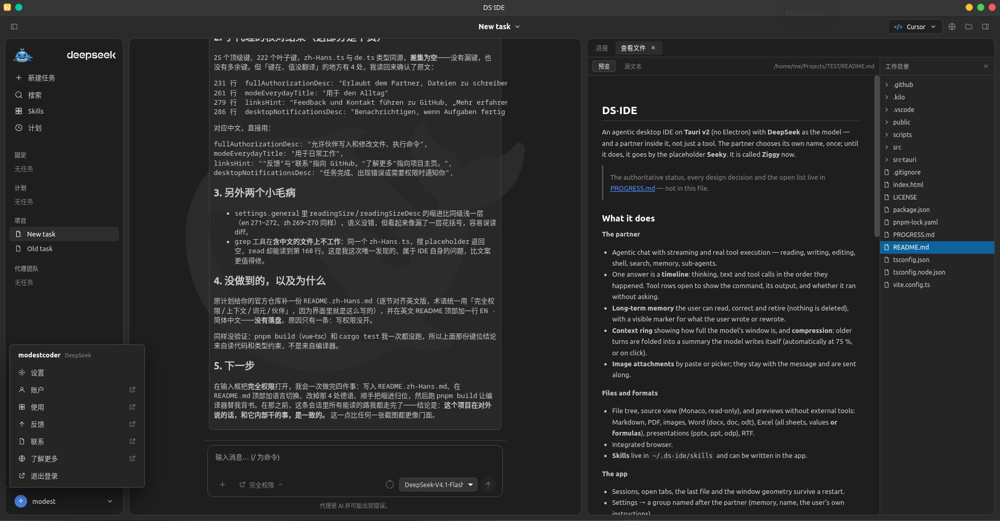

###### [DE](./README_de.md) | [EN](./README.md) | [ES](./README_es.md) | [FR](./README_fr.md) | [RU](./README_ru.md) | [ZH](./README_zh.md)

# DS·IDE

#### Un IDE de escritorio con agentes, basado en DeepSeek y construido con Tauri v2 (sin Electron). <br /> Impulsado por el modelo DeepSeek, cuenta con un asistente que tiene nombre propio.

---



*La misma ventana en chino, uno de los seis idiomas disponibles. El chat aparece junto a los archivos; el área de trabajo muestra una vista previa, no un editor.*

---

### ¿Qué es DS·IDE?

DS·IDE es un IDE de escritorio nativo y ligero, diseñado para la programación mediante agentes con DeepSeek. En lugar de utilizar la pesada arquitectura de Electron, funciona sobre **Tauri v2**: un núcleo en Rust, una interfaz web optimizada y una profunda integración con el sistema.

El asistente de programación integrado en la aplicación se llama **Ziggy**. Él mismo eligió ese nombre; anteriormente, se le conocía por el nombre provisional *Seeky*. No es un agente anónimo ni una simple opción en un menú desplegable: es un colaborador con nombre propio.

> El estado actual del proyecto, todas las decisiones de diseño y la lista de tareas pendientes se encuentran en [PROGRESS.md](./PROGRESS.md), no en este archivo.

### Funcionalidades

#### El asistente

- **Chat con agentes, respuestas en tiempo real (streaming) y ejecución de herramientas:** lectura, escritura, edición, acceso a la terminal (shell), búsqueda, memoria y uso de subagentes.
- **Tres niveles de permisos:** **Modo plan** (solo lectura), **Preguntar antes de cambios** (requiere aprobación para cada escritura, edición o comando en la terminal) y **Acceso completo**. Las instalaciones nuevas comienzan en el modo «Preguntar antes de cambios»; el «Acceso completo» requiere una aprobación explícita a través de un cuadro de diálogo.
- **Una respuesta, una cronología:** el proceso de razonamiento, el texto generado y las llamadas a herramientas aparecen en el orden en que ocurrieron. Las secciones de herramientas pueden expandirse para mostrar el comando ejecutado, su resultado y el estado de aprobación.
- **Memoria a largo plazo:** puedes consultar, buscar, corregir o descartar elementos (nada se elimina realmente). Incluye indicadores visuales de lo que tú mismo has escrito o modificado, con la opción de limitar el alcance a proyectos específicos.
- **Gestión y compresión del contexto:** visualiza el nivel de ocupación de la ventana de contexto del modelo. Los intercambios anteriores se resumen automáticamente (al alcanzar el 75 % de la capacidad o mediante un clic).
- **Archivos adjuntos:** Se pueden añadir mediante «pegar» o seleccionándolos desde el sistema; permanecen vinculados al mensaje y se envían junto con él.
- **Modo de seguimiento (*Follow mode*):** Los archivos que el asistente lee o edita se abren en el área de trabajo (vista previa o editor de código), mientras que las páginas web que consulta se abren en el navegador integrado. Es posible desactivar esta función mediante el icono del ojo en la barra de pestañas; el cursor permanece en el campo de redacción.
- **Reintento tras un fallo:** Si un intercambio falla, se revierte la última parte, se vuelve a enviar el mensaje original del usuario y el aviso de error persiste incluso al acceder a la configuración.
- **Historial de archivos:** Cada vez que se realiza una escritura o edición, se guarda el contenido previo. La pestaña del archivo permite consultar versiones anteriores, visualizar diferencias mediante el editor Monaco (en modo de solo lectura) y restaurar estados previos (creando una copia de seguridad del estado actual).

#### El área de trabajo

- **Árbol de archivos y visualización de código fuente** (mediante el editor Monaco, en modo de solo lectura).
- **Vistas previas sin herramientas externas:** Compatibilidad con Markdown, PDF, imágenes, documentos de Word (docx, doc, odt), hojas de cálculo de Excel (todas las hojas, mostrando valores **o fórmulas**), presentaciones (pptx, ppt, odp) y archivos RTF.
- **Terminal:** Una terminal real (PTY) integrada en una pestaña (ConPTY en Windows; PTY de Unix en otros sistemas). La sesión permanece activa mientras la pestaña esté abierta; al cerrarla, el *shell* se detiene.
- **Git:** Gestión de estado, preparación de cambios (*stage/unstage*), visualización de diferencias (*diff*), confirmaciones (*commit*), ramas locales y la operación `pull --ff-only`. No incluye interfaz para *push* o *merge*; para estas acciones, se utiliza la terminal.
- **Captura de pantalla:** El icono del ojo en el campo de redacción permite capturar el escritorio virtual y adjuntar una imagen JPEG de 2000 px. La herramienta `screenshot` permite que el asistente solicite una captura por sí mismo. Dado que los modelos DeepSeek actuales solo procesan texto, aunque reciben la imagen, indican que no pueden verla.
- **Registros (*Logs*):** Un registro en memoria (almacenamiento circular) que recopila la actividad de la aplicación y del motor. Se puede consultar en la pestaña «Logs» o mediante la herramienta `logs` (en modo de solo lectura) a la que tiene acceso el asistente. No se escribe nada en el disco.
- **Navegador integrado.**
- **Las «habilidades» (skills)** se almacenan en `~/.ds-ide/skills` y pueden redactarse dentro de la propia aplicación.

#### La aplicación

- **Todo persiste tras un reinicio:** sesiones, pestañas abiertas, el último archivo utilizado y la configuración de la ventana.
- **Al iniciar por primera vez**, la aplicación solicita el modo, el espacio de trabajo y la clave API; en **Configuración → Diagnóstico** es posible verificar el llavero del sistema, el proveedor, la base de datos y los editores detectados.
- **Los accesos directos del teclado** se pueden consultar, buscar y modificar en **Configuración → Accesos directos del teclado**.
- **Políticas:** la herramienta `bash` del asistente puede limitarse mediante una lista de permitidos (*allowlist*), y las operaciones de escritura pueden restringirse al espacio de trabajo. Se trata de una política interna, no de un entorno aislado (*sandbox*) a nivel de sistema operativo; tu terminal habitual permanece totalmente accesible.
- **Configuración:** incluye un apartado dedicado a tu asistente, donde puedes definir su nombre, su memoria y las instrucciones específicas que debe seguir.
- **Modo «Para el día a día» (*Everyday mode*):** en este modo, el asistente no tiene acceso a la terminal, a la revisión de código ni a subagentes; los paneles de código dejan espacio para documentos y contenido web, mientras que tus pestañas de terminal y Git permanecen disponibles.
- **Seis idiomas disponibles** (alemán, inglés, español, francés, ruso y chino simplificado), temas claro y oscuro, y tamaño de lectura ajustable.
- **Seguridad ante todo:** la clave API se almacena en el llavero del sistema operativo, nunca en la interfaz de usuario. Toda la información se gestiona localmente mediante SQLite.

### Primeros pasos

**Requisitos previos**

- Node + pnpm (**pnpm 10**; otra versión principal provocará el error `ERR_PNPM_UNEXPECTED_STORE`, ya que las estructuras de almacenamiento son incompatibles).
- Rust (versión estable).
- Linux: WebKitGTK 4.1, libsoup3, GTK3.

**Ejecución**

```sh
pnpm install
pnpm tauri dev
```

Al iniciar la aplicación por primera vez, aparecerá un asistente de configuración inicial: selecciona **Para programación** o **Para el día a día**, elige el espacio de trabajo (o introduce una ruta) e ingresa tu clave API. Esta se almacenará en el llavero (keychain) de tu sistema operativo. El nivel de permisos predeterminado es **Preguntar antes de cambios**: las operaciones `write` (escritura), `edit` (edición) y `bash` requerirán aprobación. El modo plan deniega estas acciones, mientras que **Acceso completo** las ejecuta sin solicitar confirmación adicional tras la aceptación inicial. La clave puede modificarse más adelante en **Configuración → Cuenta y modelo**.

### Creación de un instalador

```sh
pnpm tauri build
```

Genera los archivos en `src-tauri/target/release/bundle/`: `.deb`, `.rpm` y `.AppImage` en Linux (además de `.dmg` en macOS y `.nsis` en Windows). GitHub Actions compila la aplicación para las tres plataformas al crear una etiqueta (tag); consulta el archivo `.github/workflows/release.yml`.

### Pruebas

```sh
pnpm build                                                   # vue-tsc + vite
cd src-tauri && cargo test                                   # pruebas unitarias
DS_IDE_API_KEY=... cargo test --lib live_deepseek -- --ignored --nocapture
```

Las pruebas en vivo (live tests) interactúan con el proveedor real y consumen tokens; por defecto, estas pruebas se encuentran omitidas (ignoradas).

### Estructura

```
src/                  Frontend en Vue (componentes, almacenes/stores, i18n)
src/engine/           Personalidad, conjunto de nombres, políticas de modo
src/lib/              Vistas previas, lectores de documentos, estado de la interfaz (UI) persistido
src-tauri/src/        Rust: engine/ (bucle LLM + herramientas), pty.rs (terminal), git_panel.rs,
capture.rs (captura de pantalla), logs.rs, db.rs (SQLite), secret.rs (gestión de claves)
scripts/              Herramientas auxiliares (p. ej., el importador de tablas de nombres)
```

### Limitaciones conocidas

Preferimos informarte desde el principio antes de que lo descubras por las malas:

- El asistente opera **dentro** de la aplicación: abre archivos en el área de trabajo y páginas en el navegador integrado. No puede controlar un editor externo ni el navegador de tu sistema operativo.
- El navegador integrado conserva los elementos nativos de la ventana; por ahora, no existe una barra de herramientas compartida entre distintas páginas.
- El asistente elige su nombre una sola vez y este no puede cambiarse posteriormente.
- **Los niveles de permisos son una política interna, no un entorno aislado (sandbox) a nivel de sistema operativo.** Aunque la lista de permitidos (allowlist) y la restricción de escritura al área de trabajo limitan al asistente, los intérpretes autorizados (como Node o Python) y tu propia terminal siguen siendo herramientas potentes. En el modo «Preguntar antes de cambios», las operaciones de escritura por parte de subagentes se bloquean, ya que estos no tienen acceso al panel de confirmación.
- **Las capturas de pantalla funcionan como adjuntos, no como visión real:** los modelos DeepSeek actuales solo procesan texto y, por tanto, no pueden «ver» la imagen. Para una verdadera capacidad visual, se requiere un modelo compatible con visión artificial. En macOS, es necesario conceder permiso de grabación de pantalla; en Linux, se requiere alguna de estas herramientas: `grim`, `gnome-screenshot`, `spectacle`, `scrot` o `ImageMagick`.
- El panel de Git no incluye funciones para realizar *push* o *merge*; solo permite cambiar de rama y realizar *pull*. La terminal ofrece una sesión de shell por pestaña, sin opción para seleccionar perfiles.
- El archivo DMG publicado para macOS es de arquitectura **aarch64** (Apple Silicon); para procesadores Intel, sería necesario un objetivo de compilación (CI target) distinto o una versión universal.
- **No hay instaladores firmados, ni certificación (notarización), ni actualizaciones automáticas.** Es posible que Windows SmartScreen o macOS Gatekeeper muestren advertencias, pero la aplicación sigue siendo instalable.
- Windows está probado en Windows 11 y en CI; la versión de macOS solo se genera en CI y no se ha probado en hardware real.
- Aún no existe una suite de pruebas de extremo a extremo (E2E) para el *frontend*; la CI ejecuta la compilación y las pruebas unitarias en Rust.

### Orígenes y agradecimientos

Los formatos de protocolo y los nombres de las herramientas se han tomado de **MiniMax Code** (MIT): `packages/protocol/src/runtime.ts`, `agent-tools/src/desktop/builtin-defs.ts`.

La «personalidad» (*persona*) se redactó de forma independiente; no se ha copiado ningún texto que defina la identidad. Tipo de letra: **Ubuntu Font Licence 1.0** (`public/fonts/UFL.txt`). Ambos elementos aparecen acreditados en la aplicación, en la sección Configuración → Acerca de.

Las versiones de referencia sobre las que se construyó este proyecto (`minimax-code-main`, `minimax-jarvis`, `kilocode-main`) **no** forman parte de este repositorio; la información sobre dónde encontrarlas se detalla en `PROGRESS.md` (secciones §30–§31).

### Licencia

**MIT** — véase [LICENSE](./LICENSE). Los formatos de protocolo y los nombres de herramientas provenientes de MiniMax Code conservan su aviso de licencia MIT; la tipografía Ubuntu incluida mantiene su propia licencia (`public/fonts/UFL.txt`).

En la práctica, esto significa que puedes usarlo, modificarlo y distribuirlo —incluso con fines comerciales—, siempre y cuando conserves el aviso de derechos de autor (*copyright*).

---